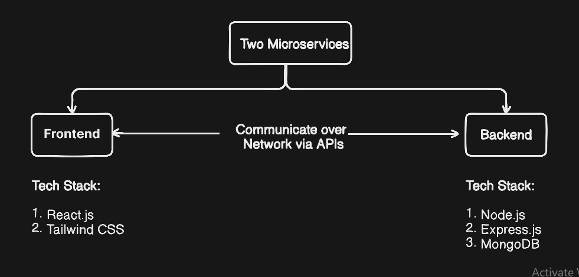

<!-- 
Example:
Why MongoDB?

Because:
- flexible schema
- good for rapid development

Why JWT authentication instead of sessions?

Because:
- stateless
- easier scaling
- widely used in REST APIs
-->


# HIGH LEVEL DESIGN
## System Interactions


## System Architecture 
### Decoupled Architecture implemented using Microservices


#### Why I Chose Decoupled Architecture:
    1. Independent Scalability
    2. Parallel Development
    3. Technology Flexibility
    4. Resilience and Fault Isolation
    5. A single backend can serve multiple frontends  simultaneously, such as a website, mobile app, and IoT devices, without code duplication.
#### Trade-offs:
    1. Latency and Network Overhead:
            Because components communicate over the network via APIs, this architecture can introduce latency, requiring optimization and caching to maintain performance.

## Sequence Flow Diagram TODO


---

# Technology Stack

## 1. Node.js

**Why Node.js?**

* Used JavaScript across both frontend and backend → reduced context switching
* Enabled quick development of APIs for core features
* Large ecosystem (npm) helped integrate required functionalities faster

**In this project:**

I used Node.js to build backend services such as:

* User authentication (signup/login)
* Profile management
* Matching logic

It allowed me to rapidly prototype and handle multiple user requests efficiently.

---

## 2. Express.js

**Why Express.js?**

* Simplified API development with a clean routing structure
* Middleware support helped organize authentication and validation logic
* Reduced complexity compared to using raw Node.js HTTP modules

**In this project:**

Express was used to:

* Define REST APIs (e.g., `/signup`, `/login`, `/profile`)
* Handle middleware for:

  * JWT authentication
  * Request validation
* Structure backend logic in a modular and maintainable way

---

## 3. React

**Why React?**

* Required a dynamic and interactive UI (similar to real-world apps)
* Avoided full page reloads → smoother user experience
* Component-based structure made UI easier to manage

**In this project:**

React was used to build:

* User interface for profile browsing and interactions
* Dynamic features like:

  * Swiping profiles
  * Viewing matches
  * Updating user data

State management helped keep the UI in sync with backend data efficiently.

---
Good. I’ll extend your README with **MongoDB + JWT + Deployment**, keeping the same tone: practical, project-driven, not theory-heavy.

---

# Database

## 4. MongoDB

**Why MongoDB?**

* Flexible schema → useful during early development when requirements change
* Easy integration with Node.js
* Stores data in JSON-like format → natural fit with JavaScript


**In this project:**

MongoDB was used to store:

* User profiles
* Authentication data
* Matches / interactions


**Practical reasoning:**

```text
While building the project, I didn’t want to spend too much time designing rigid schemas.
MongoDB allowed me to iterate quickly and modify fields as features evolved.
```


**Key learning:**

* Schema design still matters even in NoSQL
* Used indexes for faster queries (e.g., searching users)

---

# Authentication

## 5. JSON Web Token (JWT)

**Why JWT?**

* Stateless authentication → no need to store sessions on server
* Scales better for API-based applications
* Simple to integrate with frontend

---

**In this project:**

JWT was used for:

* User authentication after login
* Protecting private routes (e.g., profile, matches)

---

**Flow implemented:**

```text
1. User logs in
2. Server generates JWT
3. Token sent to client
4. Client sends token in headers for future requests
5. Backend verifies token before giving access
```

---

**Practical reasoning:**

```text
I chose JWT because my frontend and backend are decoupled.
Session-based auth would require server-side storage.
```

---

**Important learning:**

* Proper token validation is critical
* Middleware made authentication reusable across routes

---
# API Design
## 6. REST APIs
### Why REST APIs?
- Standard way for frontend and backend to communicate
- Keeps frontend and backend decoupled
- Easy to test, debug, and scale
- Uses simple HTTP methods (GET, POST, PATCH, DELETE)

### In this project:

REST APIs were used for:

- User authentication (signup/login)
- Fetching and updating user profiles
- Handling user interactions (matches)

---
<!-- # Deployment TODO

## Deployment Strategy


**Approach used:**

* Frontend deployed separately
* Backend hosted as an API service

## Typical Setup TODO

* Frontend: Vercel / Netlify
* Backend: Render / Railway
* Database: MongoDB Atlas


**In this project:**

```text
- Frontend is hosted and served as static files
- Backend exposes REST APIs
- Database is hosted in cloud (MongoDB Atlas)
```


**Real challenges faced:**

* Handling environment variables securely
* Fixing CORS issues between frontend and backend
* Managing API URLs between local and production -->