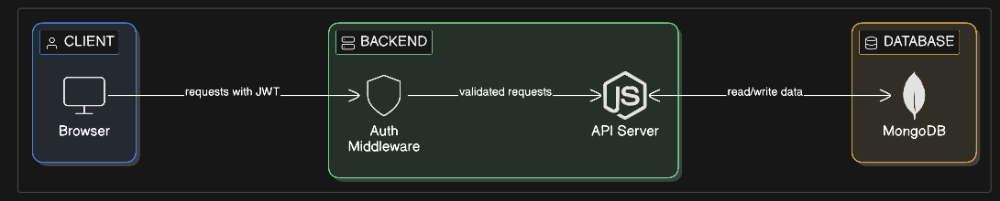
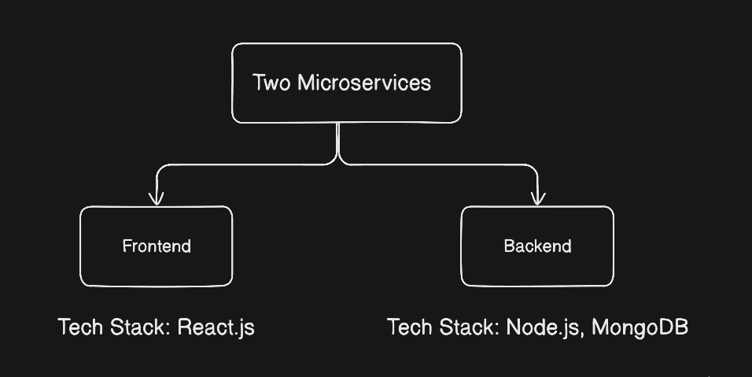
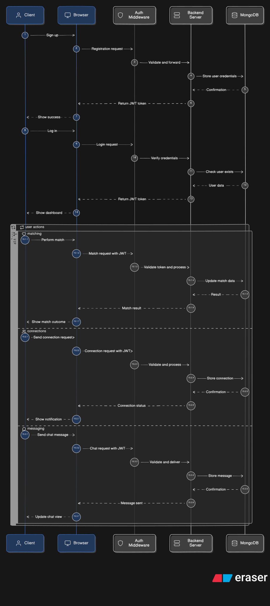

<!-- 
Example:
Why MongoDB?

Because:
- flexible schema
- good for rapid development

Why JWT authentication instead of sessions?

Because:
- stateless
- easier scaling
- widely used in REST APIs
-->

# TODO: HIGH LEVEL DESIGN
## System Interactions TODO

## System Architecture TODO

## Sequence Flow Diagram TODO

## Database Design

### Database
#### Why MongoDB?
#### Because:
- At the designing phase, I had only a basic idea about what data to include in my database. i.e., Users data, Connections data, etc. 
- I have no detailed idea of what fields to include in each document. So I decided to modify project data schema as needed during the development phase.
- So I needed a flexibility to change my data schema. 
Mongodb fulfills ny need.

## Technology Stack
### 1. Nodejs
#### Why Nodejs?
#### Because:
- TODO

### 2. Expressjs
#### Why Expressjs?
#### Because:
- TODO

### 3. Reactjs
#### Why Reactjs?
#### Because:
- TODO